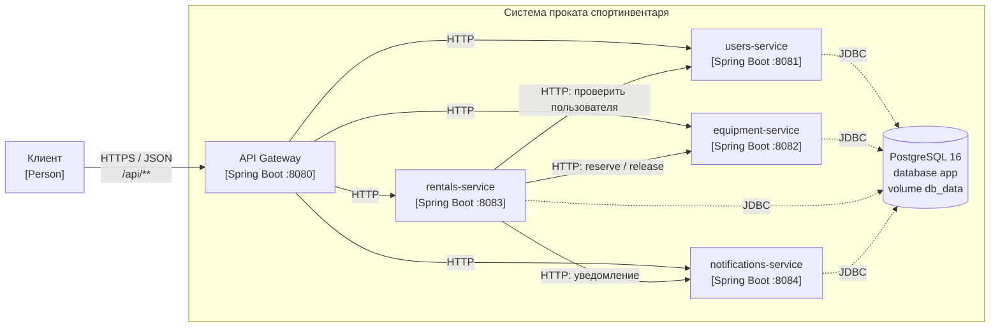
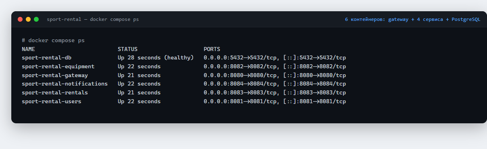
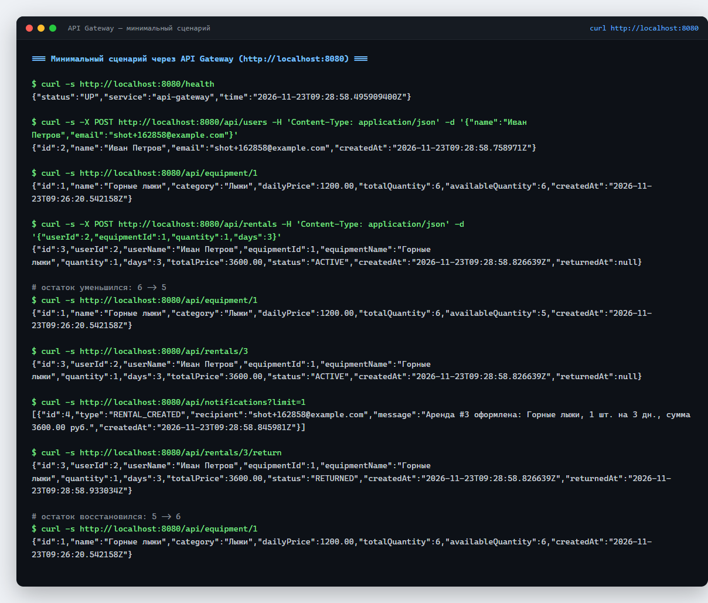
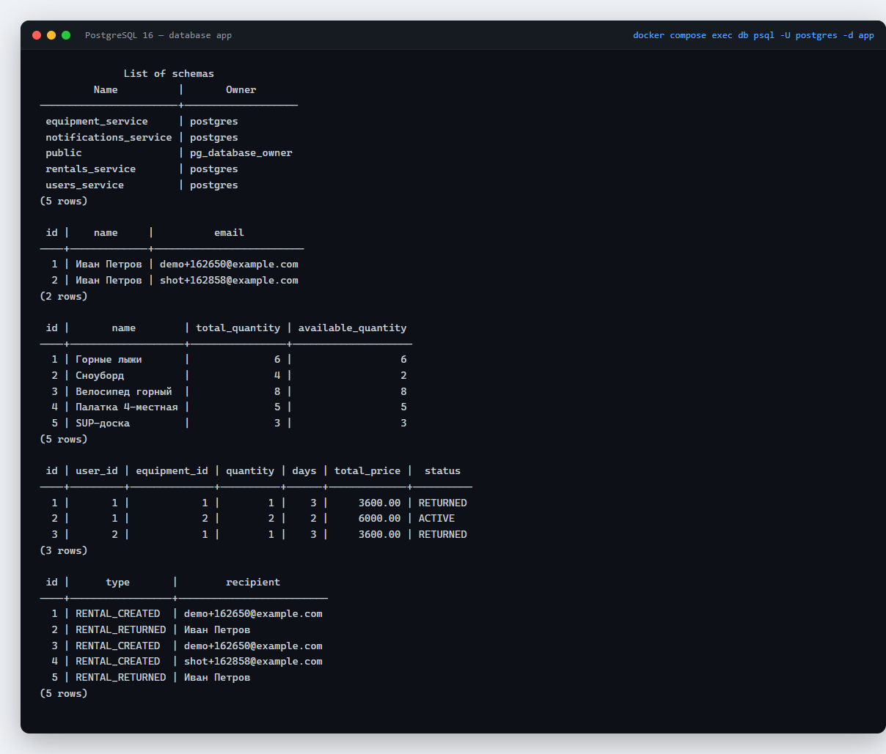
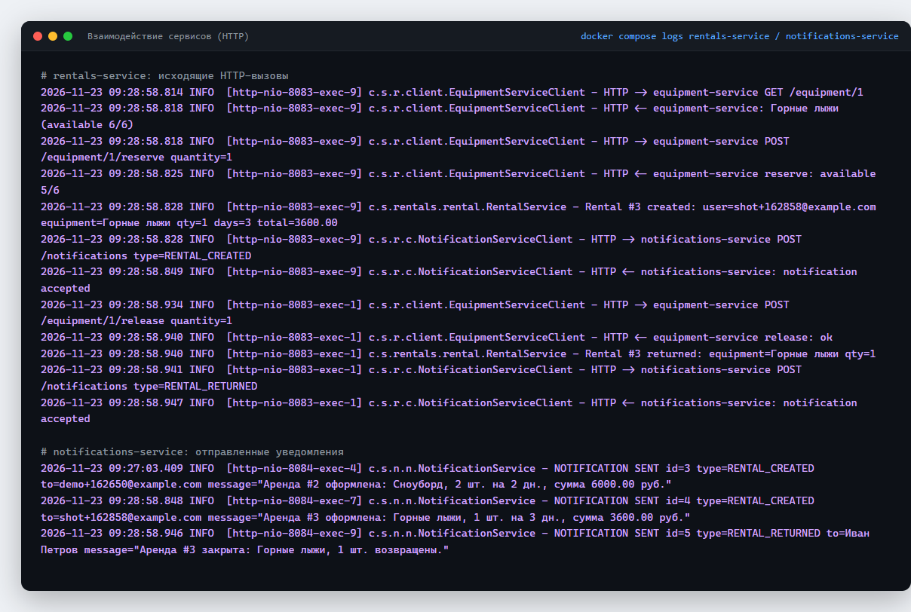
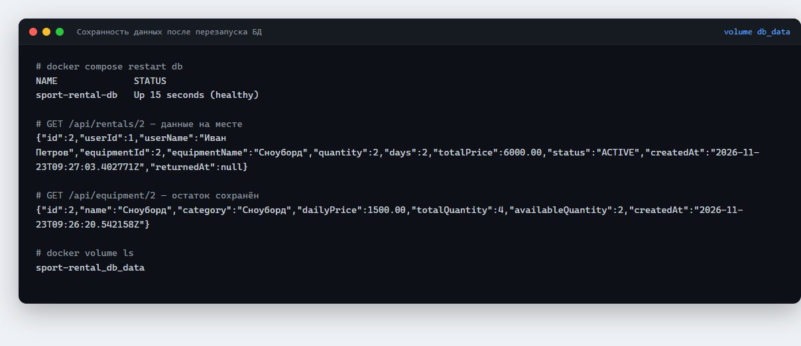
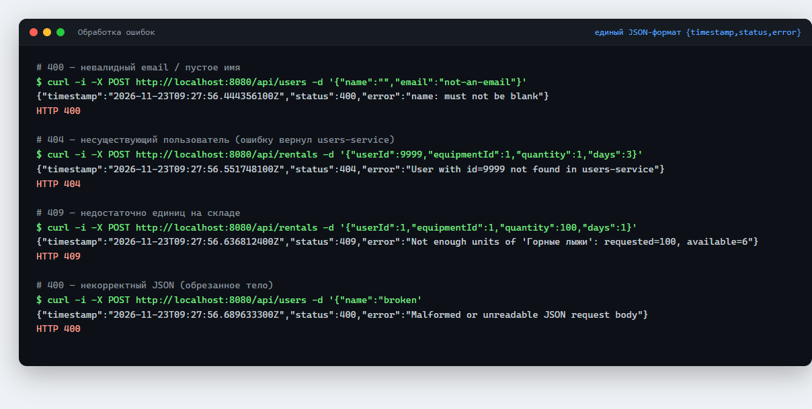

# Прокат спортивного инвентаря — микросервисный финальный проект

Учебный проект по курсу «Микросервисы и Docker»: система из **4 микросервисов + API Gateway + PostgreSQL**, которая запускается одной командой `docker compose up` и проверяется через `curl` / Postman.

Тема: **система проката спортивного инвентаря** (лыжи, сноуборды, велосипеды, палатки, SUP-доски).
Пользовательский сценарий: клиент регистрируется → смотрит каталог → оформляет аренду → получает уведомление → возвращает инвентарь.

> Индивидуальная тема и минимальный сценарий описаны в разделе «Идея и сценарий». Проект не повторяет темы других работ: это не polls / habit tracker / basketball league, а предметная область пункта проката спортинвентаря.

---

## Содержание

- [Идея и сценарий](#идея-и-сценарий)
- [Архитектура (C4)](#архитектура-c4)
- [Сервисы](#сервисы)
- [Технологии](#технологии)
- [Модель данных](#модель-данных)
- [Взаимодействие сервисов](#взаимодействие-сервисов)
- [Запуск](#запуск)
- [Проверка через curl](#проверка-через-curl)
- [Скрипты и Postman](#скрипты-и-postman)
- [Проверка сохранности данных](#проверка-сохранности-данных)
- [API](#api)
- [Логирование](#логирование)
- [Конфигурация через environment](#конфигурация-через-environment)
- [Структура проекта](#структура-проекта)
- [Скриншоты](#скриншоты)
- [Соответствие критериям](#соответствие-критериям)
- [Публикация на GitHub](#публикация-на-github)

---

## Идея и сценарий

**Задача системы:** вести каталог спортивного инвентаря, оформлять аренду конкретному пользователю, учитывать доступные остатки и фиксировать события уведомлений.

**Минимальный пользовательский сценарий:**

1. создать пользователя;
2. посмотреть каталог инвентаря;
3. создать аренду (пользователь + инвентарь + количество + срок);
4. получить аренду по `id`;
5. увидеть, что сервис уведомлений записал событие;
6. вернуть инвентарь и убедиться, что остаток восстановился;
7. перезапустить PostgreSQL и убедиться, что данные сохранились.

**Почему тема индивидуальна:** это отдельная предметная область — пункт проката спортинвентаря с учётом остатков (`available_quantity`), резервированием и возвратом единиц. Она не повторяет типовые учебные темы (опросы, трекер привычек, баскетбольная лига) и не пересекается с ними по сценарию.

---

## Архитектура (C4)

### Схемы в репозитории

| Уровень C4 | Файл |
| --- | --- |
| Context | [`docs/architecture-context.png`](docs/architecture-context.png) |
| Container | [`docs/architecture-container.png`](docs/architecture-container.png) |
| Component (`rentals-service`) | [`docs/architecture-component.png`](docs/architecture-component.png) |
| Все уровни одним листом | [`docs/architecture.png`](docs/architecture.png) |
| Редактируемая схема (diagrams.net) | [`docs/architecture.drawio`](docs/architecture.drawio) |

Схемы сгенерированы из одного описания программой [`docs/tools/C4Generator.java`](docs/tools/C4Generator.java): `java docs/tools/C4Generator.java`. Поэтому PNG, combined-лист и `.drawio` всегда согласованы.

Подробное текстовое описание по методологии C4 (Context, Container, Component) — в [`docs/architecture/ARCHITECTURE.md`](docs/architecture/ARCHITECTURE.md).

### Container-диаграмма (Mermaid)



**Как читать C4-схемы:**

- **Context (уровень 1):** кто пользуется системой (клиент, администратор) и какая внешняя система есть (имитация канала уведомлений). Внутреннее устройство здесь не показывается.
- **Container (уровень 2):** контейнеры — API Gateway, четыре Spring Boot сервиса и PostgreSQL. Показаны протоколы: HTTP между контейнерами, JDBC к базе.
- **Component (уровень 3):** внутреннее устройство `rentals-service`: `RentalController` → `RentalService` → `RentalRepository` + HTTP-клиенты к другим сервисам. Компоненты не смешаны с контейнерами: внешние сервисы вынесены за границу и подписаны как `[Container]`.

---

## Сервисы

| Сервис | Порт | Ответственность | Основные эндпоинты |
| --- | --- | --- | --- |
| `api-gateway` | 8080 | Единая точка входа, маршрутизация `/api/{service}/**`, сквозной `X-Request-Id` | `GET /`, `GET /health` |
| `users-service` | 8081 | Пользователи проката | `POST/GET /users`, `GET /users/{id}` |
| `equipment-service` | 8082 | Каталог инвентаря, остатки, атомарное резервирование/возврат | `POST/GET /equipment`, `GET /equipment/{id}`, `POST /equipment/{id}/reserve`, `POST /equipment/{id}/release` |
| `rentals-service` | 8083 | Оформление и возврат аренды, расчёт стоимости, оркестрация вызовов | `POST/GET /rentals`, `GET /rentals/{id}`, `POST /rentals/{id}/return` |
| `notifications-service` | 8084 | Имитация уведомлений: запись в БД + лог в консоль | `POST/GET /notifications` |
| `db` | 5432 | PostgreSQL 16 (собственный `Dockerfile` на базе `postgres:16`), одна БД `app`, volume `db_data` | — |

Дополнительно у каждого сервиса есть `GET /health`.

**Изоляция:** каждый сервис — отдельная папка, отдельный `pom.xml`, отдельный `Dockerfile`, отдельный контейнер и отдельная схема в БД. Общего кода между сервисами нет, они общаются только по HTTP.

---

## Технологии

- **Java 21**, **Spring Boot 3.3.5** (Web MVC, JDBC, Validation)
- **Maven** (сборка внутри Docker multi-stage)
- **PostgreSQL 16** (базовый образ `postgres:16`, `db/Dockerfile` добавляет скрипт инициализации схем), доступ через `JdbcTemplate` (без ORM — проще и прозрачнее для защиты)
- **Docker / Docker Compose** (`docker-compose.yml`, сеть `app-net`, volume `db_data`)
- **REST + JSON**, клиенты на `RestClient` (Spring 6)
- **Postman-коллекция** + **bash/PowerShell скрипты** для проверки
- **draw.io** + генератор схем на Java2D для C4

---

## Модель данных

Одна база `app`, внутри — по схеме на сервис (логическая изоляция данных):

| Схема | Таблица | Назначение |
| --- | --- | --- |
| `users_service` | `users` | `id`, `name`, `email` (unique), `created_at` |
| `equipment_service` | `equipment` | `id`, `name` (unique), `category`, `daily_price`, `total_quantity`, `available_quantity` |
| `rentals_service` | `rentals` | `id`, `user_id`, `user_name`, `equipment_id`, `equipment_name`, `quantity`, `days`, `total_price`, `status` (`ACTIVE`/`RETURNED`), `created_at`, `returned_at` |
| `notifications_service` | `notifications` | `id`, `type`, `recipient`, `message`, `created_at` |

Схемы и таблицы создаются идемпотентно: `db/init/01-init.sql` при первом старте контейнера и `schema.sql` каждого сервиса (`CREATE ... IF NOT EXISTS`). Демо-каталог инвентаря засевается `ON CONFLICT DO NOTHING`, поэтому повторный запуск не создаёт дубликаты.

Стоимость аренды считает `rentals-service`: `daily_price × quantity × days`. Названия пользователя и инвентаря сохраняются в аренде как снимок, чтобы история не зависела от последующих изменений справочников.

---

## Взаимодействие сервисов

```
POST /api/rentals
  └─ api-gateway
       └─ rentals-service
            1. GET  http://users-service:8081/users/{id}            -> проверить пользователя
            2. GET  http://equipment-service:8082/equipment/{id}    -> цена и остаток
            3. POST http://equipment-service:8082/equipment/{id}/reserve -> атомарно уменьшить остаток
            4. INSERT rentals (PostgreSQL, schema rentals_service)
            5. POST http://notifications-service:8084/notifications -> уведомление
```

- Резервирование выполняется SQL-запросом `UPDATE ... WHERE available_quantity >= ? RETURNING ...`, поэтому остаток не может уйти в минус даже при параллельных запросах.
- Если сохранение аренды в БД упало, `rentals-service` делает компенсирующий `release`, чтобы не оставить «зависший» резерв.
- Если недоступен `notifications-service`, аренда всё равно сохраняется: уведомление — побочный эффект, ошибка только логируется.
- Если недоступен `users-service` или `equipment-service`, `rentals-service` возвращает `503` с понятным сообщением.
- Gateway добавляет заголовок `X-Request-Id`; каждый сервис пишет его в лог, поэтому один запрос можно проследить по всем контейнерам.

---

## Запуск

### Требования

- Docker Desktop или Docker Engine с Compose v2 (`docker compose version`)
- Свободные порты `8080–8084`; порт PostgreSQL по умолчанию `5432` (можно изменить через `DB_PORT`)
- Скачивание базовых образов и Maven-зависимостей при первой сборке (нужен интернет)

### Команды

```bash
# из корня репозитория
docker compose up -d --build
```

Первая сборка занимает несколько минут (Maven скачивает зависимости; кэш `maven-repo` переиспользуется между сборками).

```bash
# состояние контейнеров: 6 сервисов должны быть running
docker compose ps

# проверка gateway
curl http://localhost:8080/health

# логи всех сервисов
docker compose logs -f

# логи только аренды (видно HTTP-вызовы между сервисами)
docker compose logs -f rentals-service
```

### Остановка

```bash
docker compose down          # остановить и удалить контейнеры, данные в volume остаются
docker compose down -v       # остановить и удалить volume db_data (данные пропадут)
```

### Если порт 5432 занят

Создайте `.env` (пример — `.env.example`):

```
DB_PORT=5433
```

---

## Проверка через curl

Ниже — минимальный сценарий целиком. Те же запросы есть в Postman-коллекции и в скриптах `scripts/demo.sh` / `scripts/demo.ps1`.

Все запросы идут через API Gateway на `http://localhost:8080`.

### 1. Health

```bash
curl http://localhost:8080/health
```

```json
{"status":"UP","service":"api-gateway","time":"2026-11-23T09:06:17.310391100Z"}
```

### 2. Создать пользователя

```bash
curl -X POST http://localhost:8080/api/users \
  -H "Content-Type: application/json" \
  -d '{"name":"Иван Петров","email":"ivan@example.com"}'
```

```json
{
  "id": 1,
  "name": "Иван Петров",
  "email": "ivan@example.com",
  "createdAt": "2026-11-23T09:06:17.840992Z"
}
```

### 3. Посмотреть каталог

```bash
curl http://localhost:8080/api/equipment
```

```json
[
  {"id":1,"name":"Горные лыжи","category":"Лыжи","dailyPrice":1200.00,"totalQuantity":6,"availableQuantity":6},
  {"id":2,"name":"Сноуборд","category":"Сноуборд","dailyPrice":1500.00,"totalQuantity":4,"availableQuantity":4},
  ...
]
```

### 4. Создать аренду

```bash
curl -X POST http://localhost:8080/api/rentals \
  -H "Content-Type: application/json" \
  -d '{"userId":1,"equipmentId":1,"quantity":1,"days":3}'
```

```json
{
  "id": 1,
  "userId": 1,
  "userName": "Иван Петров",
  "equipmentId": 1,
  "equipmentName": "Горные лыжи",
  "quantity": 1,
  "days": 3,
  "totalPrice": 3600.00,
  "status": "ACTIVE",
  "createdAt": "2026-11-23T09:06:18.469969Z",
  "returnedAt": null
}
```

### 5. Получить аренду

```bash
curl http://localhost:8080/api/rentals/1
```

### 6. Проверить остаток и уведомление

```bash
# остаток уменьшился: было 6, стало 5
curl http://localhost:8080/api/equipment/1

# в журнале уведомлений появилось событие RENTAL_CREATED
curl "http://localhost:8080/api/notifications?limit=5"
```

```json
[
  {
    "id": 1,
    "type": "RENTAL_CREATED",
    "recipient": "ivan@example.com",
    "message": "Аренда #1 оформлена: Горные лыжи, 1 шт. на 3 дн., сумма 3600.00 руб.",
    "createdAt": "2026-11-23T09:06:18.675091Z"
  }
]
```

### 7. Вернуть инвентарь

```bash
curl -X POST http://localhost:8080/api/rentals/1/return
```

```json
{
  "id": 1,
  "status": "RETURNED",
  "returnedAt": "2026-11-23T09:06:18.811206Z",
  "...": "остальные поля аренды без изменений"
}
```

```bash
# остаток снова 6
curl http://localhost:8080/api/equipment/1
```

### 8. Ошибки (проверка валидации и связей)

```bash
# 400 — невалидный email
curl -i -X POST http://localhost:8080/api/users \
  -H "Content-Type: application/json" \
  -d '{"name":"","email":"not-an-email"}'

# 404 — нет такого пользователя (ошибку вернул users-service, её пробросил rentals-service)
curl -i -X POST http://localhost:8080/api/rentals \
  -H "Content-Type: application/json" \
  -d '{"userId":9999,"equipmentId":1,"quantity":1,"days":3}'

# 409 — недостаточно единиц на складе
curl -i -X POST http://localhost:8080/api/rentals \
  -H "Content-Type: application/json" \
  -d '{"userId":1,"equipmentId":1,"quantity":100,"days":1}'
```

Фактический вывод всех команд и логи контейнеров сохранены в [`docs/verification.md`](docs/verification.md). Полный справочник запросов (включая Windows/PowerShell-варианты) — [`docs/curl-examples.md`](docs/curl-examples.md).

---

## Скрипты и Postman

Сценарий можно воспроизвести тремя способами — все проверены на запущенной системе.

**bash / Linux / macOS / Git Bash:**

```bash
bash scripts/demo.sh
```

**Windows PowerShell:**

```powershell
powershell -ExecutionPolicy Bypass -File scripts/demo.ps1
```

Скрипты создают пользователя, оформляют аренду у первой позиции каталога, читают её, показывают уведомление, возвращают инвентарь и проверяют восстановление остатка. Имя пользователя и email уникальны (email содержит текущее время), поэтому сценарий можно запускать повторно.

> В Git Bash под Windows тело запроса с кириллицей отправляется через `--data-binary @-` (stdin): аргументы командной строки для `curl.exe` перекодируются в ANSI и иначе ломают UTF-8.

**Postman:** импортируйте [`postman/SportRental.postman_collection.json`](postman/SportRental.postman_collection.json). Переменная `baseUrl` по умолчанию `http://localhost:8080`. Запросы в папках Health / Users / Equipment / Rentals / Notifications выполняются по порядку; тесты создания сохраняют `userId`, `equipmentId`, `rentalId` в переменные коллекции.

---

## Проверка сохранности данных

```bash
# аренда существует
curl http://localhost:8080/api/rentals/1

# перезапускаем только базу
docker compose restart db

# ждём, пока Postgres поднимется, и повторяем запрос — данные на месте
sleep 10
curl http://localhost:8080/api/rentals/1
```

Данные лежат в именованном volume `db_data`:

```bash
docker volume ls | grep sport-rental
docker volume inspect sport-rental_db_data
```

Удаление контейнеров (`docker compose down`) не удаляет `db_data`; данные исчезают только при `docker compose down -v`.

---

## API

### Users Service (`/api/users`)

| Метод | Путь | Тело | Ответ |
| --- | --- | --- | --- |
| POST | `/api/users` | `{"name":"...","email":"..."}` | 201, пользователь |
| GET | `/api/users` | — | 200, массив |
| GET | `/api/users/{id}` | — | 200 / 404 |

### Equipment Service (`/api/equipment`)

| Метод | Путь | Тело | Ответ |
| --- | --- | --- | --- |
| POST | `/api/equipment` | `{"name":"...","category":"...","dailyPrice":1200.00,"totalQuantity":5}` | 201 |
| GET | `/api/equipment?category=Лыжи` | — | 200, массив |
| GET | `/api/equipment/{id}` | — | 200 / 404 |
| POST | `/api/equipment/{id}/reserve` | `{"quantity":1}` | 200 / 409 |
| POST | `/api/equipment/{id}/release` | `{"quantity":1}` | 200 / 404 |

### Rentals Service (`/api/rentals`)

| Метод | Путь | Тело | Ответ |
| --- | --- | --- | --- |
| POST | `/api/rentals` | `{"userId":1,"equipmentId":1,"quantity":1,"days":3}` | 201 / 404 / 409 / 503 |
| GET | `/api/rentals?userId=1&status=ACTIVE` | — | 200, массив |
| GET | `/api/rentals/{id}` | — | 200 / 404 |
| POST | `/api/rentals/{id}/return` | — | 200 / 404 / 409 |

### Notifications Service (`/api/notifications`)

| Метод | Путь | Тело | Ответ |
| --- | --- | --- | --- |
| POST | `/api/notifications` | `{"type":"...","recipient":"...","message":"..."}` | 201 |
| GET | `/api/notifications?limit=50` | — | 200, массив |

Формат ошибок у всех сервисов одинаковый:

```json
{
  "timestamp": "2026-11-23T09:06:29.182330300Z",
  "status": 409,
  "error": "Not enough units of 'Горные лыжи': requested=100, available=5"
}
```

---

## Логирование

Каждый сервис пишет в консоль (stdout/stderr Docker):

- старт приложения и ошибки;
- каждый HTTP-запрос фильтром `RequestLoggingFilter`: метод, путь, статус, длительность, `X-Request-Id`;
- бизнес-события: создание пользователя, резервирование, создание аренды, отправка уведомления.

`notifications-service` дополнительно печатает строку вида:

```
NOTIFICATION SENT id=1 type=RENTAL_CREATED to=ivan@example.com message="Аренда #1 оформлена: ..."
```

`rentals-service` логирует исходящие вызовы:

```
HTTP -> users-service GET /users/1
HTTP <- users-service GET /users/1: Иван Петров <ivan@example.com>
HTTP -> equipment-service POST /equipment/1/reserve quantity=1
HTTP <- equipment-service reserve: available 5/6
HTTP -> notifications-service POST /notifications type=RENTAL_CREATED
```

Смотреть: `docker compose logs -f rentals-service`.

---

## Конфигурация через environment

Ничего не захардкожено в коде: адреса и порты приходят из `docker-compose.yml`.

| Переменная | Где используется | Значение в compose |
| --- | --- | --- |
| `SPRING_DATASOURCE_URL` | все сервисы с БД | `jdbc:postgresql://db:5432/app` |
| `SPRING_DATASOURCE_USERNAME` | все сервисы с БД | `postgres` |
| `SPRING_DATASOURCE_PASSWORD` | все сервисы с БД | `1234` |
| `SERVER_PORT` | все сервисы | `8080–8084` |
| `USERS_SERVICE_URL` | gateway, rentals | `http://users-service:8081` |
| `EQUIPMENT_SERVICE_URL` | gateway, rentals | `http://equipment-service:8082` |
| `RENTALS_SERVICE_URL` | gateway | `http://rentals-service:8083` |
| `NOTIFICATIONS_SERVICE_URL` | gateway, rentals | `http://notifications-service:8084` |
| `DB_PORT` | compose (хост) | `5432` |

В `application.yml` у каждой переменной есть локальное значение по умолчанию (например, `localhost:5432`), поэтому сервис можно запустить и вне Docker для отладки.

---

## Структура проекта

```
.
├── api-gateway/
│   ├── Dockerfile
│   ├── pom.xml
│   └── src/main/java/com/sportrental/gateway/
│       ├── ApiGatewayApplication.java
│       ├── GatewayController.java      # проксирование /api/**
│       ├── GatewayProperties.java
│       └── ...
├── users-service/
│   ├── Dockerfile
│   ├── pom.xml
│   └── src/main/{java,resources}/...
├── equipment-service/
│   ├── Dockerfile
│   ├── pom.xml
│   └── src/main/{java,resources}/...
├── rentals-service/
│   ├── Dockerfile
│   ├── pom.xml
│   └── src/main/java/com/sportrental/rentals/
│       ├── rental/                     # controller, service, repository
│       ├── client/                     # HTTP-клиенты к другим сервисам
│       ├── dto/
│       └── ...
├── notifications-service/
│   ├── Dockerfile
│   ├── pom.xml
│   └── src/main/{java,resources}/...
├── db/
│   ├── Dockerfile                      # FROM postgres:16 + init-скрипт
│   └── init/01-init.sql                # схемы БД при первом старте
├── docs/
│   ├── architecture.drawio             # редактируемая схема (3 страницы)
│   ├── architecture-context.png
│   ├── architecture-container.png
│   ├── architecture-component.png
│   ├── architecture.png                # все уровни одним листом
│   ├── architecture/ARCHITECTURE.md    # текстовое описание C4
│   ├── screenshots/                    # снимки работающей системы (6 PNG)
│   ├── verification.md                 # фактический вывод проверки
│   ├── curl-examples.md                # справочник запросов curl
│   └── tools/C4Generator.java          # генератор схем
├── postman/SportRental.postman_collection.json
├── scripts/
│   ├── demo.sh
│   └── demo.ps1
├── docker-compose.yml
├── .env.example
└── README.md
```

---

## Скриншоты

Реальные снимки работающей системы (вывод команд оформлен в виде терминала). Исходные PNG — в [`docs/screenshots/`](docs/screenshots/).

**1. Запуск Docker Compose — 6 контейнеров:**



**2. Минимальный сценарий через API Gateway (curl):**



**3. Данные в PostgreSQL (схемы и таблицы):**



**4. Взаимодействие сервисов по HTTP (логи):**



**5. Сохранность данных после перезапуска БД:**



**6. Обработка ошибок (400 / 404 / 409):**



Диаграммы C4 — в разделе [Архитектура](#архитектура-c4).

---

## Соответствие критериям

| Критерий | Где смотреть |
| --- | --- |
| Идея и сценарий | раздел «Идея и сценарий», `docs/verification.md` |
| Минимум 3 сервиса с отдельной ответственностью и API | 4 сервиса, таблица «Сервисы» |
| Взаимодействие через HTTP | `rentals-service/client/*`, схема Container, логи `HTTP -> ...` |
| PostgreSQL как сервис `db`, volume `db_data` | `docker-compose.yml`, раздел «Проверка сохранности данных» |
| Dockerfile для каждого сервиса | папки сервисов |
| Docker Compose: сеть, environment, volumes | `docker-compose.yml` |
| C4: Context, Container, Component | `docs/*.png`, `docs/architecture.drawio` |
| README | этот файл |
| Проверка результата | `docs/verification.md`, `docs/screenshots/`, `scripts/demo.sh`, Postman-коллекция |

---

