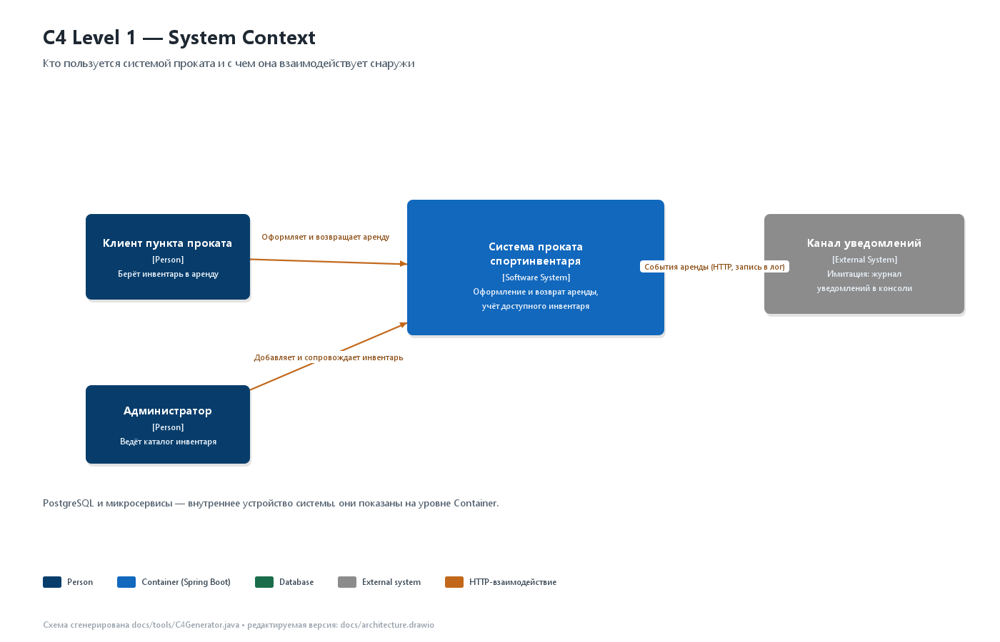
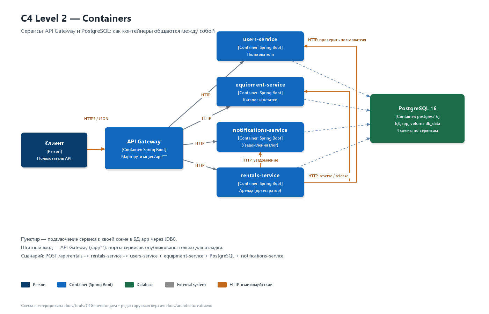
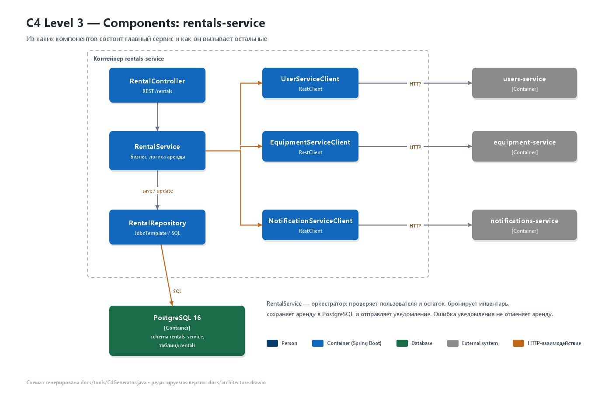

# Архитектура системы проката спортинвентаря (C4)

Документ описывает архитектуру по методологии **C4** на трёх уровнях:
**Context → Container → Component**. Для каждого уровня есть диаграмма (PNG) и
редактируемая страница в [`docs/architecture.drawio`](../architecture.drawio).
Все схемы генерируются из одного описания программой
[`docs/tools/C4Generator.java`](../tools/C4Generator.java), поэтому PNG и `.drawio`
всегда согласованы: `java docs/tools/C4Generator.java`.

---

## Уровень 1 — System Context



**Вопрос уровня:** кто пользуется системой и с чем она взаимодействует снаружи?

| Элемент | Тип | Роль |
| --- | --- | --- |
| Клиент пункта проката | Person | Берёт инвентарь в аренду и возвращает его |
| Администратор | Person | Ведёт каталог инвентаря и сопровождает остатки |
| Система проката спортинвентаря | Software System | Оформление и возврат аренды, учёт доступного инвентаря |
| Канал уведомлений | External System | Имитация доставки уведомлений (журнал в консоли и БД) |

На этом уровне внутреннее устройство системы **не показывается** — только границы
системы, её пользователи и внешняя зависимость. PostgreSQL и микросервисы — это
внутренние детали, они раскрываются на уровне Container.

---

## Уровень 2 — Containers



**Вопрос уровня:** из каких контейнеров (приложений и хранилищ) состоит система и
как они общаются?

| Контейнер | Технология | Порт | Ответственность |
| --- | --- | --- | --- |
| API Gateway | Spring Boot (Web MVC) | 8080 | Единая точка входа, маршрутизация `/api/{service}/**`, сквозной `X-Request-Id` |
| users-service | Spring Boot + JDBC | 8081 | Пользователи проката |
| equipment-service | Spring Boot + JDBC | 8082 | Каталог инвентаря, остатки, атомарное резервирование/возврат |
| rentals-service | Spring Boot + JDBC | 8083 | Оформление и возврат аренды, расчёт стоимости, оркестрация HTTP-вызовов |
| notifications-service | Spring Boot + JDBC | 8084 | Имитация уведомлений: запись в БД + лог в консоль |
| PostgreSQL 16 | postgres:16 | 5432 | Одна БД `app`, четыре схемы по сервисам, volume `db_data` |

**Протоколы:**

- Клиент → Gateway: HTTP/JSON, путь `/api/**`.
- Gateway → сервисы: HTTP (проксирование).
- rentals-service → users/equipment/notifications: HTTP (`RestClient`).
- Каждый сервис → PostgreSQL: JDBC (`JdbcTemplate`), своя схема.

**Ключевой сценарий (`POST /api/rentals`):**

```
api-gateway
  └─ rentals-service
       1. GET  users-service/users/{id}              — проверить пользователя
       2. GET  equipment-service/equipment/{id}      — цена и остаток
       3. POST equipment-service/equipment/{id}/reserve — атомарно уменьшить остаток
       4. INSERT rentals (schema rentals_service)
       5. POST notifications-service/notifications   — уведомление
```

Пунктирные линии на диаграмме — подключение сервиса к своей схеме в БД через JDBC.
Штатный вход — API Gateway; порты сервисов 8081–8084 опубликованы только для отладки.

---

## Уровень 3 — Components (rentals-service)



**Вопрос уровня:** из каких компонентов состоит главный сервис-оркестратор и как
он вызывает остальные контейнеры?

| Компонент | Тип | Назначение |
| --- | --- | --- |
| `RentalController` | REST-контроллер | Принимает `/rentals`, валидирует входные DTO |
| `RentalService` | Бизнес-логика | Оркестратор: проверяет пользователя и остаток, бронирует инвентарь, сохраняет аренду, отправляет уведомление |
| `RentalRepository` | Доступ к данным | `JdbcTemplate` / SQL, таблица `rentals_service.rentals` |
| `UserServiceClient` | HTTP-клиент (`RestClient`) | Вызов users-service |
| `EquipmentServiceClient` | HTTP-клиент (`RestClient`) | Вызов equipment-service (get / reserve / release) |
| `NotificationServiceClient` | HTTP-клиент (`RestClient`) | Вызов notifications-service |

Внешние сервисы (`users-service`, `equipment-service`, `notifications-service`) и
PostgreSQL вынесены **за границу контейнера** и подписаны как `[Container]` —
компоненты не смешиваются с контейнерами.

**Поведение оркестратора:**

- Резервирование выполняется SQL-запросом
  `UPDATE ... WHERE available_quantity >= ? RETURNING ...`, поэтому остаток не уходит
  в минус даже при параллельных запросах.
- Если сохранение аренды в БД упало — компенсирующий `release`, чтобы не оставить
  «зависший» резерв.
- Ошибка уведомления **не отменяет** аренду: уведомление — побочный эффект, ошибка
  только логируется.
- Недоступность users/equipment-service → `503` с понятным сообщением.

---

## Изоляция и данные

- Каждый сервис — отдельная папка, `pom.xml`, `Dockerfile`, контейнер и схема в БД.
  Общего кода между сервисами нет; общение только по HTTP.
- Одна БД `app`, схемы: `users_service`, `equipment_service`, `rentals_service`,
  `notifications_service`. Сервисы не обращаются к таблицам друг друга.
- Схемы и таблицы создаются идемпотентно (`CREATE ... IF NOT EXISTS`): скрипт
  `db/init/01-init.sql` при первом старте контейнера и `schema.sql` каждого сервиса.
- Данные лежат в именованном volume `db_data` и переживают `docker compose restart db`
  и `docker compose down` (удаляются только при `down -v`).

## Файлы схем

| Уровень | PNG | Страница в .drawio |
| --- | --- | --- |
| Context | [`architecture-context.png`](../architecture-context.png) | C4 Context |
| Container | [`architecture-container.png`](../architecture-container.png) | C4 Container |
| Component | [`architecture-component.png`](../architecture-component.png) | C4 Component |
| Все уровни | [`architecture.png`](../architecture.png) | — |

Редактируемый файл: [`docs/architecture.drawio`](../architecture.drawio) (открывается
в [diagrams.net](https://app.diagrams.net)).
